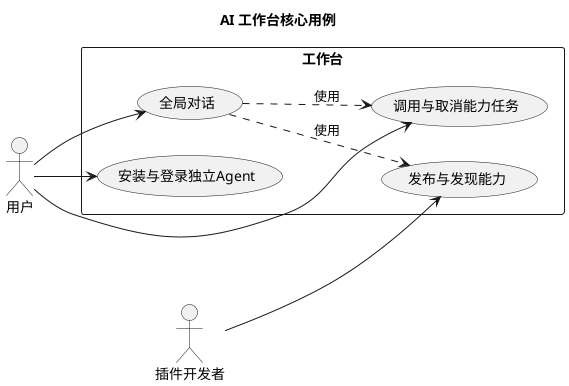
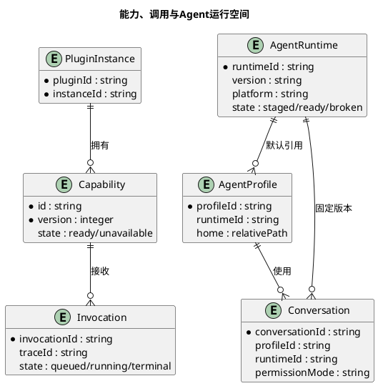
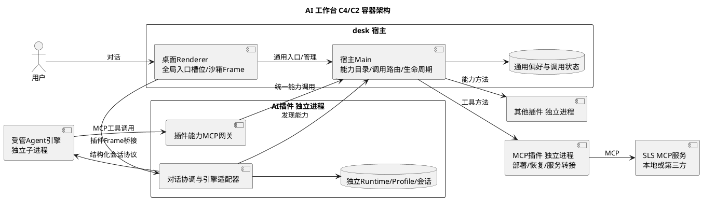
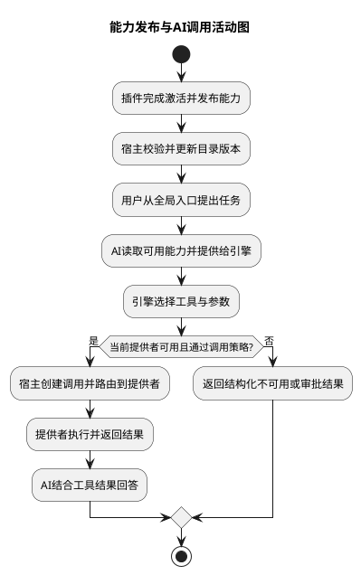
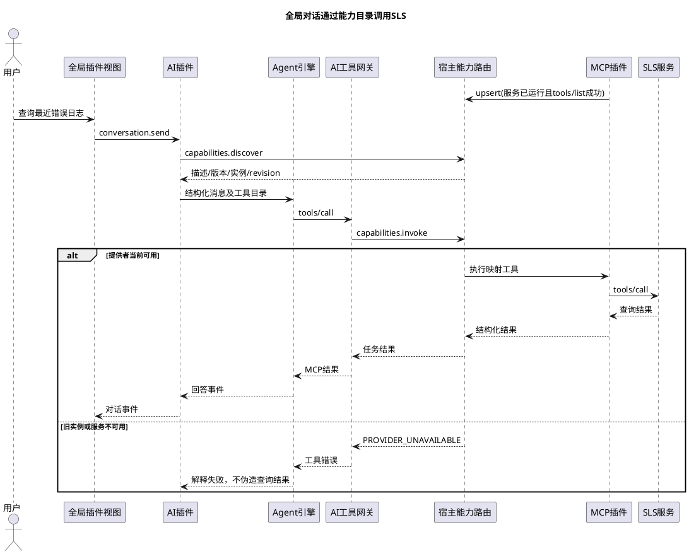
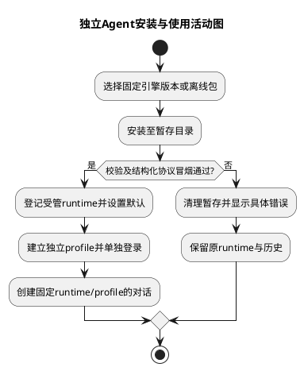
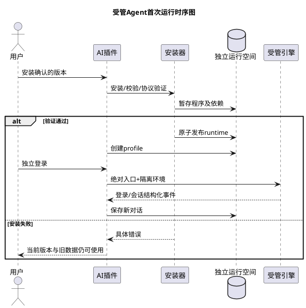
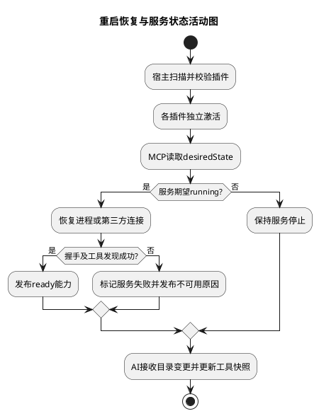
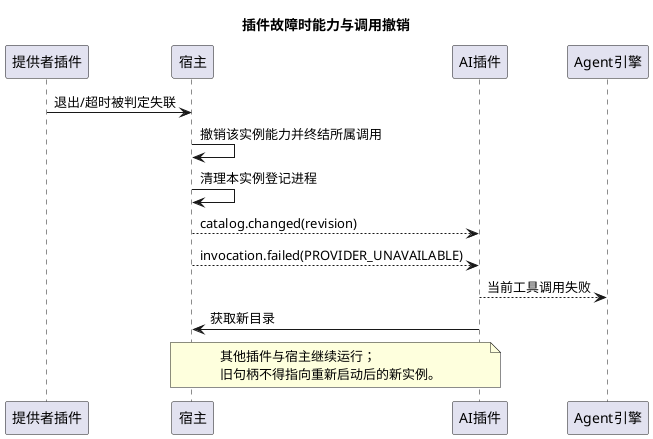

# AI 工作台能力协议与 Agent 独立运行空间改造方案

> 状态：用户已确认，2026-10-24 已实施；实际接口见 plugin-api.md。独立账号未登录，真实模型调用未验证。
> 范围：全局对话入口、插件能力注册/发现/调用、AI Agent 独立安装与运行、MCP 接入及兼容迁移。
> 依据：2026-10-24 用户确认及当前源码核对；产物供用户自行安装，不迁移系统认证、不提交。

## 一、需求理解

### 1. 需求一句话与场景抽象

| 项目 | 结论 |
|---|---|
| 一句话需求 | 用户通过工作台全局对话入口，由独立安装运行的 AI Agent 发现并调用插件能力完成任务。 |
| 场景抽象 | 单机桌面上的可发现插件协作，以及由 AI 组织执行的工具调用。 |
| 主要矛盾 | AI 需要理解、组合不同插件的能力，但现有协议只有方法路由，Agent 又依赖系统 CLI 和环境，难以保持稳定、独立、可恢复的执行边界。 |
| 范围边界 | desk 承担通用能力目录、路由、任务状态和入口挂载；AI 插件承担对话、Agent 引擎与工具适配；MCP 插件承担服务部署、管理和转接。 |
| 验收指标 | 移除系统 PATH 中的 Agent CLI 后仍可对话并调用工具；宿主重启后无需重填配置即可恢复标记为自动启动的 SLS 服务并在新对话调用；插件故障后目录撤销且宿主、其他插件可操作。 |

**已确认：**工作台有全局 AI 对话入口，由 AI Agent 插件承接；插件应对工作台发布能力，也能发现其他插件；Agent 安装与 OS 已安装的 Agent 独立；保留数据，不提交代码。

**现状证据：**

| 当前实现 | 位置 | 本次设计需要补齐的部分 |
|---|---|---|
| `services.register/discover/invoke`，按 contract 发布后台方法；限制循环、最多八跳、继承调用截止时间 | `desk/src/main/common/plugin-worker.js`、`plugins.js` | 结构化能力描述、动态目录、可用状态、长任务与取消 |
| 后台独立 worker，视图独立站点 frame；插件退出有清理路径 | `plugin-runtime.js`、`plugin-view.js` | 将能力目录、对话挂载和任务统一纳入同一运行实例生命周期 |
| 默认命令为 `codex`；PTY 启动时合并 `process.env`；适配器只覆盖日志目录 | AI 插件 `adapters/codex.js`、`sessions.js` | 独立程序、引擎运行依赖、配置、认证和会话状态；显式环境构造 |
| MCP 通过 `agent.launch-config.v1` 向 Codex 注入本次启动参数 | AI 与 MCP 插件 `launch-config.js` | 让 MCP 工具与普通插件能力进入同一发现与调用通道 |
| 上次正常重启实测：插件可加载，SLS 未自动启动；手动启用后 AI 可查询 | `plugins/dist/verification/mcp-services-0.3.1/重启验证结果.md` | 区分“插件加载”和“服务期望运行状态”，补齐服务恢复 |

这些是本次源码阅读及既有验证记录，不表示本次重新做过运行验证。

### 2. 用户故事与用例图

- 用户从全局入口开始对话，无需先打开 AI 插件窗口。
- 插件开发者发布带说明和数据结构的能力，其他插件与 AI 使用同一协议调用。
- 用户在工作台内安装、登录和升级 Agent，不依赖系统 CLI，也不改写系统 Agent 配置。

全局入口与插件协作的用例。



## 二、业务与技术方案

### 3. 核心实体与数据结构

#### 3.1 核心实体关系

运行实例拥有能力与任务；会话固定其引擎版本和配置空间。



| 实体 | 归属 | 约束 |
|---|---|---|
| 能力描述 | 提供插件；宿主保留当前实例的内存快照 | 唯一键为 `pluginId + capabilityId + majorVersion`；清单提示不能直接作为可调用注册 |
| 调用记录 | 宿主通用调用层 | `invocationId` 唯一；调用者、实例 ID、trace 与截止时间由宿主绑定 |
| AgentRuntime | AI 插件 | 版本、平台和校验值固定；运行中会话引用的版本不得被原地覆盖 |
| AgentProfile | AI 插件 | 独立认证和配置空间；同一 profile 的会话共享登录，不与系统 Agent 共享 |
| Conversation | AI 插件 | 对话、工具结果与引擎上下文归插件所有；窗口关闭不等于删除历史 |

#### 3.2 持久化结构

沿用 JSON/文件存储，不为本需求新增数据库。下表均为提议，除兼容读取外不得移动现有数据。

| 变更 | userData 下路径 | 关键字段或规则 |
|---|---|---|
| 扩展 | 桌面现有 preferences | `entryProviders.globalConversation` 记录用户选择的 `{pluginId,viewId}`，不保存 AI 模型或密钥 |
| 新增 | `plugin-data/ai-agent-sessions/runtimes/index.json` | runtimeId、版本、OS/架构、来源、摘要、安装状态、相对入口、运行依赖版本 |
| 新增 | `plugin-data/ai-agent-sessions/runtimes/<runtimeId>/` | Agent 程序及必要运行依赖；独立于插件包目录与 OS 安装目录 |
| 新增 | `plugin-data/ai-agent-sessions/profiles/<profileId>/` | 独立 Agent home、认证、配置、缓存和引擎上下文；认证文件严格限制本机权限 |
| 扩展 | AI 插件现有历史/会话结构 | 增量加入 runtimeId、profileId、协议模式、conversationId；原字段与旧记录继续可读 |
| 新增 | `plugin-data/ai-agent-sessions/conversations/` | 新结构化对话、顺序事件与工具引用；与旧终端归档并存 |
| 新增 | `capability-invocations/<invocationId>.json` | 只持久化通用状态、调用链标识、时间和脱敏错误；不默认复制参数、工具全文或密钥 |
| 扩展 | MCP 插件现有服务配置 | 增量加入 `desiredState: running/stopped`；期望状态与瞬时进程状态分离 |
| 内存 | 能力目录及 catalogRevision | 从当前成功激活的实例重建；不从磁盘恢复“仍存活”的能力句柄 |

重启时，未终结调用记为 `interrupted`，不自动重放写操作。终结状态互斥：`succeeded / failed / cancelled / interrupted`。

### 4. 系统架构设计

#### 4.1 方案比较与推荐

| 选择 | 内容 | 取舍 |
|---|---|---|
| A：扩展现有 services，推荐 | 增加能力描述和任务调用，沿用现有 IPC、独立 worker 与调用约束 | 改造范围可控；需要补齐异步任务上下文和动态注册 |
| B：所有插件之间统一使用 MCP | 普通插件也实现 MCP 服务端和客户端 | 每个插件增加协议与连接管理；与现有宿主生命周期重复，不作为首期方案 |
| C：独立增加一套能力总线 | 保留 services，另建注册与调用系统 | 同时维护两套可调用状态和路由，容易不一致，不推荐 |

**推荐 A；待用户确认。** 对外新增 `context.capabilities` API，内部扩展复用现有 services 注册表与调用路由，不维护两套事实源；旧 services 接口继续兼容。新能力协议版本 `desk.capabilities.v1` 与现有插件 `apiVersion: 2` 分开，清单声明所需宿主特性，不暗中改变旧方法语义。

#### 4.2 容器职责

全局对话以通用入口槽位挂载插件视图，AI 工具网关位于 AI 插件进程。



| 模块 | 改造职责 | 边界 |
|---|---|---|
| desk | 通用 `global-conversation` 入口槽位、能力元数据校验、路由与任务、实例状态和事件投递 | 不内置模型调用、Agent 参数、MCP 业务连接、SLS 或认证规则 |
| AI Agent | 全局对话视图、受管安装、独立登录、会话、工具筛选、引擎协议适配、MCP 网关 | 禁止默认回退到系统命令；不直接读取其他插件数据目录 |
| MCP | 服务安装配置、启动停止、工具列表转换、实际 MCP 调用和期望状态恢复 | 不再负责生成特定 Codex 参数作为新架构的主要接入方式 |
| 其他插件 | 发布实际可执行能力，返回结构化结果和任务状态 | 不相互导入内部模块 |

宿主允许插件视图声明 `contributes.entries: ["global-conversation"]`。入口只挂载该插件已有隔离 frame；AI 缺失、禁用或故障时显示可恢复状态，桌面仍可操作；多个提供者要求用户选择，不能任取一个。全局入口和插件窗口默认连接同一会话服务，另开会话必须显式操作。

#### 4.3 Agent 运行空间重新设计

**推荐：工作台内受管安装，引擎版本锁定，配置与认证独立。** 保留 CLI 作为可替换引擎实现，但全局对话不再把终端输出作为主要交互协议。

| 方面 | 设计 |
|---|---|
| 安装来源 | 在 AI 插件内安装经适配验证的固定版本；程序从明确来源下载并校验，或导入符合相同清单的离线引擎包；安装前展示来源、版本及所需空间 |
| 安装事务 | 下载/解压到暂存目录 → 校验入口、依赖、版本与协议 → 标记 ready → 原子切换默认引用；失败保留当前可用版本 |
| 运行依赖 | 原生可执行包优先；需要 Node 等解释器的引擎，其依赖也放受管 runtime，不要求用户全局安装 npm/Node，不写系统全局目录 |
| 启动 | 使用受管入口的绝对路径和参数数组；构造最小环境，保留 OS 必要项并设置引擎适配器支持的专属 home/配置目录；不整包继承 shell 环境、系统 Agent 密钥或配置 |
| 配置隔离 | Codex 适配器拟显式指定独立 `CODEX_HOME`；具体固定版本是否完全遵守该目录、是否还有系统配置/凭证回退，必须通过实现阶段契约验证，不能只设置变量就宣布隔离成功 |
| 登录 | 在工作台内单独登录或配置 API 凭证；不默认读取系统 Agent 登录态；如引擎使用 OS 凭证存储，需确认可采用独立命名空间，否则不得声明严格隔离 |
| 工作目录 | 用户选择的真实项目目录继续可用；“独立空间”指程序与运行状态独立，不是把项目复制进去，也不是限制文件访问的安全沙箱 |
| 升级 | 显式安装新版本，经过冒烟验证后作为新会话默认；存量会话引用旧版本，旧版本无引用后才清理 |
| 交互协议 | 全局对话使用结构化输入、文本增量、工具请求、审批、完成和错误；首期只支持一个经过验证的 Codex 引擎版本，其他 CLI 必须提供等价适配能力 |
| 终端兼容 | 现有终端会话与历史保留；终端可作为高级视图，不能通过解析屏幕文字推断工具调用或审批 |

同一 profile 的认证和必要配置可共享；每个 conversation 有独立引擎上下文 ID 和日志。旧会话恢复/分叉继续绑定来源 profile，不能只复制 contextId 到新 home 就声称可恢复。

### 5. 核心业务流程

#### 5.1 插件发布能力与全局对话调用

能力变更触发目录版本更新；实际执行前重新检查当前实例和版本。





MCP 每个外部工具映射一个能力，提供者归属始终是 MCP 插件；服务 ID 和原始 tool name 作为稳定映射，不能仅依赖展示名称。现有 `agent.launch-config.v1` 保留给旧会话；新会话通过一个 AI 工具网关接入，避免同一 SLS 工具双重曝光。

工具网关仅监听 loopback，使用会话级随机令牌；凭证不进入模型上下文，host 绑定调用者与会话授权。独立运行空间不改变用户选择的权限模式；能力声明不能自行扩大权限。

#### 5.2 Agent 安装、首次运行与旧数据兼容

安装成功后才允许创建受管会话；旧系统状态不被覆盖。





旧归档保持只读兼容；旧的外部引擎配置标记 legacy，不隐式改成新的独立 profile。恢复依赖系统上下文时，先明确提示需要一次性迁移，用户选择后复制必要数据并验证，失败时源数据不变；不得复制整个系统 Agent home 或全部凭证。

#### 5.3 重启恢复与故障撤销

插件就绪与服务就绪分开表示，避免注册空壳工具。





宿主退出触发的服务停止不改 `desiredState`；用户主动停服务才改 stopped。自动恢复失败只显示真实错误并允许显式重试，首期不无限重启；桌面故障重启后旧对话可查阅，不自动续跑用户任务。

### 6. 对外接口设计

#### 6.1 协议定位与通用规则

本节接口是本地 PluginContext RPC，不新增 HTTP REST 服务。`context.capabilities` 是建议新增 API；底层继续使用 postMessage/Electron IPC/Node IPC，身份由宿主绑定，不能信任 JSON 中自报的 pluginId。

| 调用 | 用途 |
|---|---|
| `capabilities.register(descriptor, handler)` | 激活时注册静态能力；worker 将处理器绑定为内部方法，宿主不执行处理器 |
| `capabilities.upsert(descriptor, handler)` / `unregister(id,version)` | 同一实例动态发布/更新/撤销，例如 MCP 服务启动、停止和 tools 变更 |
| `capabilities.discover(query)` | 查询描述、状态和当前实例句柄；默认只返回 ready |
| `capabilities.invoke(request)` | 建立异步调用，立即返回 invocationId；结果通过状态接口和定向事件获取 |
| `capabilities.getInvocation(id)` / `cancel(id)` | 获取快照或请求取消；仅调用者及获授权的同一会话可访问 |
| `capabilities.onCatalogChanged(handler)` | 持续订阅目录 revision；漏事件后重新拉取快照 |
| `capabilities.onInvocation(handler)` | 接收自己调用的顺序事件；不向所有插件广播参数和结果 |

新协议值限 JSON 可表达数据，JSON Schema 首期采用固定支持子集并在注册时拒绝不支持项。注册须包含真实用途，禁止把私有方法自动全部公开。

#### 6.2 能力注册描述

以下为普通文本插件的描述示例；处理器通过 API 参数绑定，不通过 JSON 传输代码。

```json
{
  "protocol": "desk.capabilities.v1",
  "id": "document.read",
  "version": 1,
  "title": "读取文档",
  "description": "读取用户指定路径的文本内容，返回格式和正文。",
  "inputSchema": {
    "type": "object",
    "properties": { "path": { "type": "string" } },
    "required": ["path"],
    "additionalProperties": false
  },
  "outputSchema": {
    "type": "object",
    "properties": { "text": { "type": "string" }, "format": { "type": "string" } },
    "required": ["text", "format"],
    "additionalProperties": false
  },
  "effects": ["filesystem.read"],
  "confirmation": "policy",
  "execution": { "timeoutMs": 30000, "cancellable": true, "retry": "never" }
}
```

- `effects` 首期只作为风险提示和策略输入，不能宣称为 OS 权限沙箱；未知/未声明副作用按更保守策略处理。`confirmation` 支持 policy/always，宿主策略可提高确认要求，插件不能降低用户约束。
- 运行状态由提供者报告 ready/unavailable 及脱敏原因；实例退出、禁用和版本失配由宿主覆盖为不可调用。错误描述、工具结果均是不可信业务数据，不能变成系统指令。
- 同一插件可发布多个能力；同名多提供者保留各自身份，AI 工具名包含提供者的稳定映射。能力 major version 必须精确匹配，不偷偷转换参数结构。

#### 6.3 发现与目录变更

请求：

```json
{
  "protocol": "desk.capabilities.v1",
  "id": "document.read",
  "version": 1,
  "includeUnavailable": false
}
```

响应：

```json
{
  "catalogRevision": 42,
  "providers": [{
    "handle": {
      "pluginId": "text-editor",
      "instanceId": "runtime-instance-123",
      "capabilityId": "document.read",
      "version": 1,
      "descriptorRevision": 2
    },
    "state": "ready",
    "descriptor": { "id": "document.read", "version": 1, "title": "读取文档" }
  }]
}
```

示例 descriptor 省略其余字段，正式响应必须返回 6.2 的完整描述。目录变更事件为 `{type:"catalog.changed",revision:43}`；变化包括激活、动态更新、服务停止、崩溃、禁用和卸载。能力元数据不含服务密钥或临时 Bearer。

多个提供者时，普通插件显式选择句柄；AI 根据说明和用户任务选择，写操作有歧义时要求澄清。目录全局 revision 变化不必使无关句柄失效，实例或 descriptorRevision 不匹配才拒绝本次执行并要求重新发现。

#### 6.4 调用、事件和取消

调用请求：

```json
{
  "handle": {
    "pluginId": "text-editor",
    "instanceId": "runtime-instance-123",
    "capabilityId": "document.read",
    "version": 1,
    "descriptorRevision": 2
  },
  "input": { "path": "/Users/example/project/README.md" },
  "options": { "timeoutMs": 30000 }
}
```

接收响应及后续终结事件：

```json
{
  "invocationId": "inv-001",
  "traceId": "trace-001",
  "state": "queued",
  "deadline": 1792838430000
}
```

```json
{
  "type": "invocation.finished",
  "invocationId": "inv-001",
  "sequence": 3,
  "state": "succeeded",
  "result": { "format": "md", "text": "示例正文" }
}
```

| 项目 | 明确语义 |
|---|---|
| 身份与上下文 | 宿主产生 invocationId/traceId，绑定调用者运行实例、真实调用链、会话授权和 deadline；不得接受插件伪造身份或绕过父调用截止时间 |
| 入站校验 | 检查当前实例、描述版本、JSON Schema、大小限制、调用策略和既有资源锁；输出不满足 schema 时返回明确错误 |
| 长任务 | 30 秒普通 RPC 只负责接单；实际工作通过宿主持有的任务上下文执行。根任务受宿主上限约束，嵌套任务继承父 deadline 与取消；不能靠分离 Promise 绕过有效调用上下文 |
| 超时与崩溃 | 超时先终结调用并请求取消；worker 真正失联或不能回收时走既有实例强制清理。正常耗时工具不因接单 RPC 到期直接杀插件 |
| 取消 | `cancel` 首先返回 cancelling；收到提供者确认后才能报告 cancelled。不能取消的能力返回 CANCEL_UNSUPPORTED；超时/强制关闭标记失败或中断，不能假称外部副作用已撤销 |
| 事件 | queued/running/progress/terminal，每个 invocation 单调 sequence；先返回的事件可通过快照恢复，终结恰好登记一次；流进度采用限流与有界队列 |
| 结果大小 | 控制消息先沿用现有宿主 1 MiB 入站上限；超大结果显式 RESULT_TOO_LARGE 或由提供者实现分页，不能把大文件/无限日志塞进事件流 |
| 重试 | 首期宿主不自动重放能力调用；网络重连与服务重启不能导致写操作被重复执行 |
| 重启 | 持久化的进行中调用统一 interrupted；不从旧记录恢复进程 PID，不自动补执行 |

关键错误：`PROVIDER_UNAVAILABLE`、`CAPABILITY_CHANGED`、`INPUT_INVALID`、`OUTPUT_INVALID`、`APPROVAL_REQUIRED`、`CALL_TIMEOUT`、`CANCEL_UNSUPPORTED`、`RESULT_TOO_LARGE`。业务错误使用 `{code,message,retryable,details}`，details 必须脱敏；日志包含 pluginId、instanceId、invocationId、traceId，不记录认证头和完整环境。

#### 6.5 AI 对话契约与引擎接口

AI 插件建议发布 `agent.conversation.v1`，用于其他插件请求开始或继续对话；全局视图通过自己插件的视图 RPC 调用同一实现，不在 desk 增加 AI 业务接口。

```json
{
  "action": "send",
  "conversationId": "conversation-001",
  "message": { "role": "user", "content": [{ "type": "text", "text": "查询最近五分钟SLS错误" }] }
}
```

返回 `turnId`，后续提供 `text.delta / tool.started / tool.finished / approval.required / turn.finished / turn.failed` 顺序事件。对话原文和历史归 AI 插件，宿主只做通用事件定向转发；取消一轮需向其子能力调用传递取消信号。

引擎适配器需具备结构化 `start/send/subscribe/approve/cancel/close`，并声明恢复、分叉和工具目录更新支持情况；不支持的功能明确禁用。未验证某个 Codex 版本的结构化协议前，不把“CLI 能启动”作为全局对话验收通过。

AI 工具网关实现 MCP `tools/list` 与 `tools/call`，将 JSON Schema 和调用结果映射至能力协议。新目录先由 AI 插件刷新，下轮对话使用新快照；引擎支持并验证热更新后才承诺当前轮更新，任何旧工具调用仍须经过宿主可用性检查。

MCP 插件把第三方工具的描述与 inputSchema 映射到能力目录；没有 outputSchema 的工具使用明确的通用结果封装，不能伪造结构化输出保证。SLS 上游密钥仅保留在 MCP 插件配置中。

### 7. 思考与疑问

#### 7.1 待确认的建议默认值

1. 协议采用 4.1 的 A：扩展现有 services，新增 capabilities 开发接口，保留旧契约。
2. 首期实现一个受管 Codex 引擎，独立安装、独立登录、固定版本；不继续以任意系统 CLI 作为全局对话后端。
3. Agent 首次使用时在工作台内安装；支持离线引擎包，`.plg` 本身不携带所有平台/版本引擎。是否必须“安装插件后立即离线可用”会改变包大小与分发方案。
4. 全局入口视图由 AI 插件提供；desk 通用挂载槽位不包含 AI 业务实现。该方案符合现有 AGENTS 的领域边界，不把对话逻辑下沉宿主。
5. 新增自动恢复只作用于 MCP 服务；旧服务初次升级保持当前期望状态待用户选择，不将全部曾注册服务自动启动。

以上均为待确认提案，不是已经实施或用户已经批准的决定。

#### 7.2 改造顺序、范围与验证

| 阶段 | 拟涉及文件/模块 | 与主要矛盾的对应关系 | 实际验收要求 |
|---|---|---|---|
| 1：协议基础 | desk 的 plugin-worker/runtime/plugins、IPC/共享契约及直接测试；补充插件 API/指南 | 插件有统一且可信的可发现调用入口 | 两个夹具插件完成注册、发现、调用、取消；动态更新、旧句柄、循环、超时、越权句柄均验证；旧 services 仍能调用 |
| 2：受管 Agent | `plugin-dev/ai-agent/src/main/common/` 的安装/适配/会话及 `os/`，对应界面与测试 | 消除系统程序、环境与认证依赖 | 系统无 codex/node/npm 时受管引擎仍可运行；系统 Agent 配置和认证文件不变；独立登录成功；安装中断与升级回滚；恢复/分叉可用 |
| 3：全局入口 | desk 的视图清单/入口与 renderer；AI 插件对话视图和结构化引擎适配 | 用户可直接发起 AI 任务且业务保持插件归属 | 无 AI 插件时桌面可用；入口打开正确 frame；多提供者可选择；文本流、审批、取消、重开历史验证 |
| 4：统一工具 | AI 工具网关、MCP services/index 与两插件直接契约测试 | AI 统一调用普通插件和 MCP 能力 | 同一对话真实读取文本插件内容并调用现有 SLS；不重复曝光工具；上游密钥不出现在目录和日志 |
| 5：恢复与交付 | MCP 期望状态、故障清理及集成验证；受影响文档与打包 | 重启或故障后目录和真实运行状态一致 | 重启后自动恢复指定 SLS 并由新 AI 对话真实查询；一个插件后台/视图故障不影响宿主和另一个插件；数据前后核验 |

实现前应将上述模块落到当时源码的具体修改清单；新增工作仅限本表领域及直接契约关联，不顺带改文本编辑等插件业务。指南同步明确能力描述、版本、取消、副作用、密钥处理和运行空间约定。

验证需记录执行时间、版本、关键 trace/request ID 与脱敏结果；配置及历史使用摘要比对，日志允许追加。失败也要如实报告；本草案只定义验收，不宣称任何新增能力通过实测。

#### 7.3 技术取舍与明确边界

- 独立安装/配置不等于容器或恶意插件沙箱。保留当前可信本地插件模型；能力策略、来源校验和最小环境仍需实现，OS 级权限隔离不在本期。
- CLI 固定版本的分发方式、授权条款、认证目录隔离、结构化协议、恢复/分叉兼容性需实现前核实；若无法满足，不隐式转回系统 CLI，必须反馈差异并调整方案。
- 固定引擎版本的 UI 与工具权限仍由适配器映射，保留用户已确认的三档权限意图；不能承诺未验证版本支持全部三档。
- 不新增通用工作流引擎、多 Agent 编排、在线插件市场、IDE、模型服务商直连或远程公网能力注册；这些不阻断本次全局对话与插件调用。
- 当前仓库已有大量未提交改动；本次仅新增本方案。后续需基于现状做增量修改，禁止重置已有代码、自动迁移用户密钥或提交代码。
