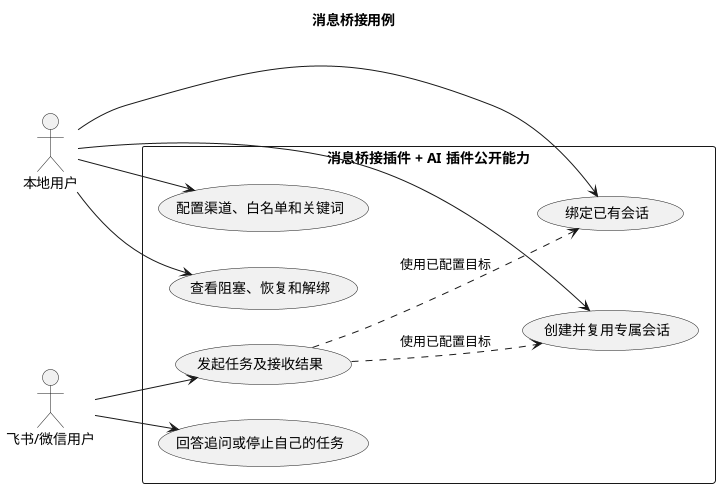
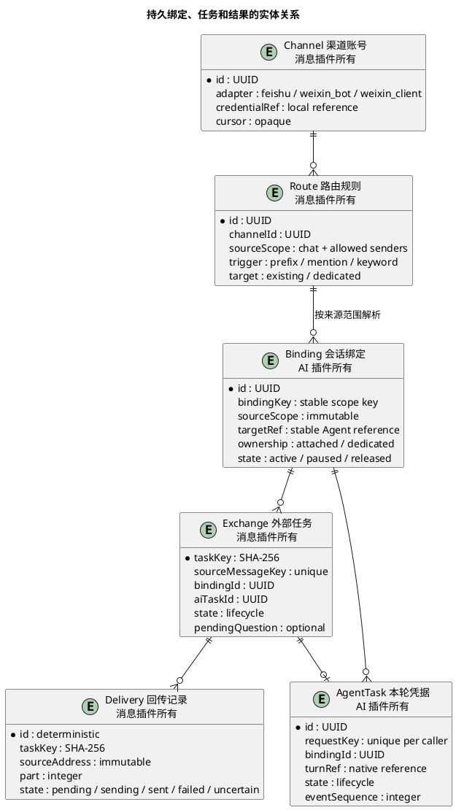
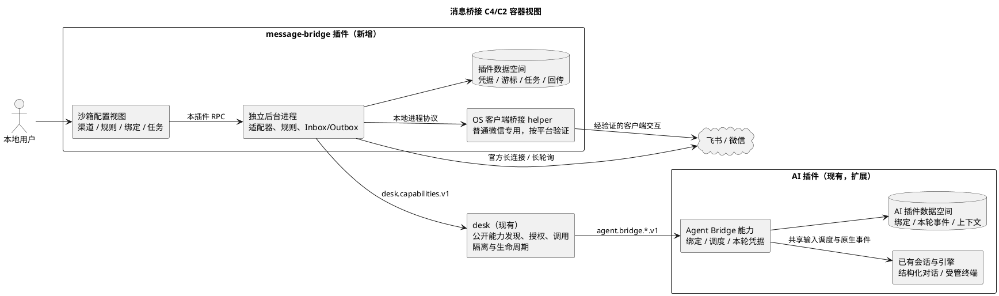
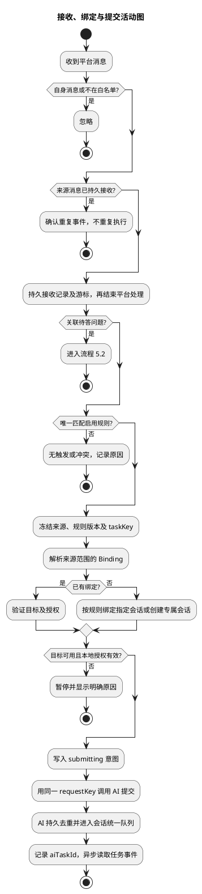
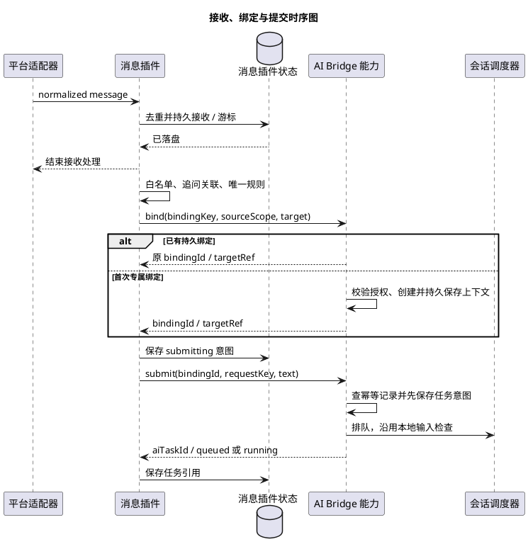
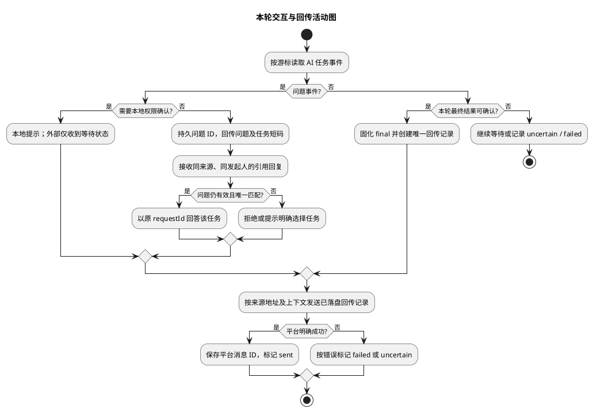
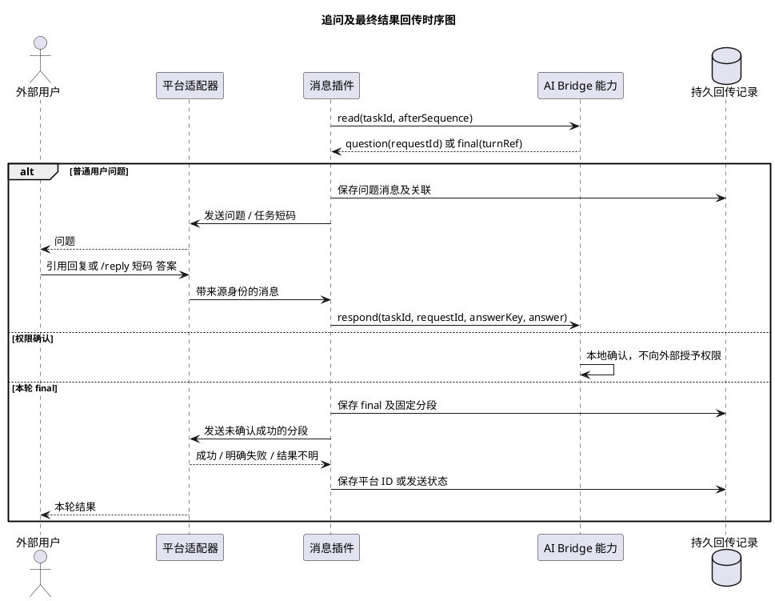
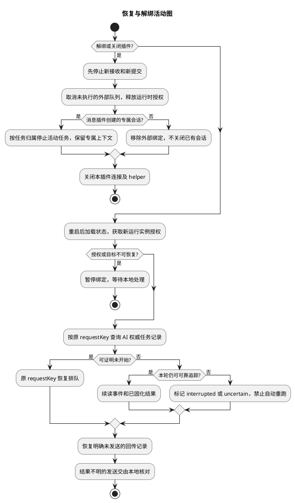
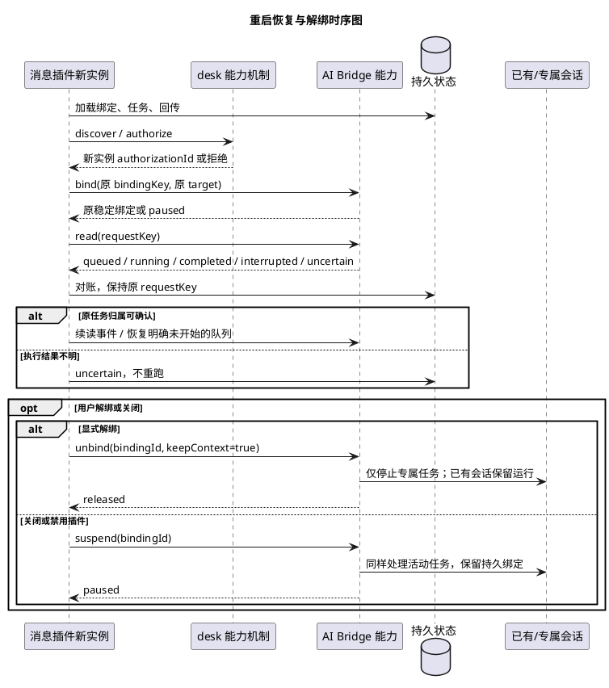

# 飞书、微信与 Agent 会话消息桥接方案

> 状态：待评审；2026-11-01。用户已确认接入方向，本文件补充设计，尚未实施。
> 范围：专用机器人及已有聊天接入；绑定已有 Agent 会话或新建并持续复用专属会话。

## 一、需求理解

### 1. 需求一句话与场景抽象

| 项目 | 结论 |
|---|---|
| 一句话需求 | 用户在飞书、微信指定聊天中通过关键词唤起已有或专属 Agent 会话，并在原聊天继续追问、接收结果。 |
| 场景抽象 | 多渠道异步消息到有状态 Agent 会话的双向任务桥接。 |
| 主要矛盾 | 外部消息可以并发、重投，Agent 会话却有独立上下文和本地交互状态；必须保证请求、会话和本轮结果准确对应，同时不覆盖本地输入。 |
| 范围边界 | 接收文本、匹配规则、会话绑定、任务提交、追问及结果回传；业务放在插件，desk 仅提供通用能力机制；普通微信聊天的可用性须通过客户端适配验证。 |
| 结果指标 | ① 同一来源消息重复投递 10 次，最多启动一个 Agent 任务；② 两渠道、两发送者并行及崩溃恢复用例中，错会话、错收件人、历史结果误回传均为 0；③ 100 次忙碌/草稿/输入状态变化测试不覆盖本地输入，飞书事件处理在 3 秒内结束。 |

设计主线：用**来源隔离的持久绑定**解决上下文对应，用**会话统一调度**解决输入竞争，用**本轮任务凭据及回传队列**解决结果归属、重复执行和重启恢复。

### 2. 用户故事与用例图

- 本地用户可选择已有 Agent 会话，让外部请求接着原上下文处理。
- 本地用户可配置按聊天、按发送者创建专属会话，后续消息持续复用。
- 外部用户可用关键词发起任务，按任务回复追问或停止，并在原聊天收到结果。
- 本地用户可查看阻塞、结果不明和发送失败，暂停规则或解绑而不销毁已有会话。



## 二、业务与技术方案

### 3. 核心实体与数据结构

#### 3.1 实体及所有权



| 实体 | 核心规则 |
|---|---|
| Channel | 凭据、游标及回复上下文留在消息插件；断线恢复游标，不能假定所有渠道均可补拉离线消息。 |
| Route | 首先校验渠道、聊天及发送者白名单，再匹配关键词；按优先级只选一条，同优先级冲突拒绝启用。 |
| Binding | `bindingKey` 由规则 ID 和规范化来源范围计算；窗口名、会话名和运行实例 ID 都不能作为持久身份；显式重新绑定产生新的 bindingId。 |
| Exchange | 接收时冻结来源地址、规则版本和绑定；后续规则修改不改变在途任务的回传地址。 |
| AgentTask | AI 插件持久记录幂等请求、提交状态及本轮事件；只提供该任务允许外发的输出。 |
| Delivery | 每条进度、追问、最终结果按任务及事件序号生成唯一 ID；长结果按渠道限制固定分段，逐段记录状态。 |

#### 3.2 存储及关键约束

**设计选择：沿用本项目插件文件持久化方式，不引入共享数据库。** 下表为逻辑集合；消息插件在自身数据目录单文件原子替换 `bridge-state.json`，更新完成后才确认接收或推进游标；提交给 AI 和向平台发送前均先落盘意图。

| 变更 | 文件/集合 | 关键字段、唯一约束及用途 |
|---|---|---|
| 新增，消息插件 | `bridge-state.json / channels` | `id` 唯一；adapter、credentialRef、cursor、connectionState。 |
| 新增，消息插件 | `bridge-state.json / routes` | `id` 唯一；version、sourceScope、trigger、priority、target、enabled。 |
| 新增，消息插件 | `bridge-state.json / bindings` | 仅保存 `bindingKey → bindingId` 引用和展示状态；AI 绑定为权威数据。 |
| 新增，消息插件 | `bridge-state.json / exchanges` | `sourceMessageKey` 唯一；taskKey、bindingId、aiTaskId、replyContextRef、state、lastEventSequence、pendingQuestion、closedAt/closeReason（外部交互关闭凭据）。 |
| 新增，消息插件 | `bridge-state.json / deliveries` | `id = taskKey:eventSequence:part` 唯一；地址快照、内容、状态、平台消息 ID、失败原因。 |
| 新增，AI 插件 | `bridge-bindings.json` | `callerPluginId + bindingKey` 唯一；sourceScope、targetRef、ownership、executionPolicy、state。 |
| 新增，AI 插件 | `bridge-tasks.json` | `callerPluginId + requestKey` 唯一；提交意图、turnRef、结果、事件序列及必要的重放去重记录。 |
| 复用，AI 插件 | 原生会话、结构化对话及事件存储 | 继续拥有模型上下文；不复制整份历史到消息插件。 |

`sourceMessageKey = channelId + 平台消息ID`；若平台 ID 只在聊天内唯一，再加入 chatId。消息 ID 不稳定、缺失时不得用文本相等代替可靠去重，该适配器暂停自动执行。

原子写需包含临时文件写入、同步、同目录替换及错误处理；失败不得确认成功。每个插件仅有一个状态写入者；跨插件一致性通过幂等查询收敛，不尝试跨文件事务。

AI 创建专属上下文前先保存绑定创建意图，以同一创建关联键记录目标；恢复时对账已创建目标，不能因绑定应答丢失而再建一个上下文。无法确认创建结果时暂停待核对，不能以“绑定尚不存在”为由重复创建。

设计默认保留消息正文与输出 30 天、去重元数据至少 90 天；清理仍保留平台可能重放范围内的去重记录。渠道不能保证重放上界时，不删除对应水位/去重标记；磁盘不足暂停接收并直接显示错误。

#### 3.3 会话映射和任务状态

| 配置方式 | 持久映射 | 后续消息行为 |
|---|---|---|
| 绑定已有会话 | 固定来源范围 → 用户选择的稳定 targetRef | 在原会话继续；目标删除、关闭或不可恢复时暂停，要求重新选择，不自动换目标。 |
| 专属会话，按发送者，默认 | routeId + channelId + chatId + senderId → 一个 targetRef | 第一次创建，之后包括重启后均复用；群内不同人上下文分开。 |
| 专属会话，按聊天 | routeId + channelId + chatId → 一个 targetRef | 明确选择后，群内允许的发送者共享上下文并排队。 |
| 多来源共享已有会话 | 多个明确批准的来源范围 → 同一 targetRef | 仅显式配置后启用，共用同一个会话调度器；不能默认把飞书与微信合并。 |

“专属会话”是可持久恢复的 Agent 上下文，不是每条消息启动一个新会话。首次配置选择引擎和工作目录；引擎安装、认证及上下文恢复仍由 AI 插件负责。

Exchange 状态：`received → queued → submitting → running ↔ waiting_input → completed / failed / cancelled / interrupted`；无法证明是否执行时进入 `uncertain`。Delivery 独立记录发送状态，Agent 完成不等于消息已发送。

### 4. 系统架构设计

#### 4.1 插件边界与现有能力



| 组件 | 当前事实 | 本方案新增职责 |
|---|---|---|
| 消息桥接插件 | 尚未实现 | 渠道及规则配置、接收去重、持久绑定引用、追问路由、结果回传。建议目录 `plugin-dev/message-bridge/`。 |
| AI 插件后台会话能力 | 已有 `agent.session.start/read/history/respond/cancel/close.v1`，用于调用方自有后台任务 | 新增独立 `agent.bridge.*.v1`；保留既有权限和行为，覆盖任意受支持已有会话的显式绑定。 |
| AI 会话输入 | 已有忙碌、草稿、输入版本、确认状态检查；会话协作投递限定同组 | 复用检查和输入提交机制，在 AI 插件内实现外部任务入口；不得伪造同组身份或放宽原协作限制。 |
| AI 结果采集 | 结构化对话有 turn/event；终端有部分原生活动/完成采集 | 结构化对话按 turn 归属；终端补齐本轮可靠边界后再启用对应引擎/版本。 |
| desk | 公开能力、进程隔离和受约束消息机制 | 原则上无需修改；`desk.channels.v1` 仅服务同插件命名空间，不能充当跨插件消息总线。 |

现状依据：[后台会话](../../plugin-dev/ai-agent/src/main/common/background-sessions.js)、[结构化对话](../../plugin-dev/ai-agent/src/main/common/conversations.js)、[会话投递](../../plugin-dev/ai-agent/src/main/common/session-messages.js)、[后台任务](../../plugin-dev/ai-agent/src/main/common/tasks.js)、[插件 API](../plugin-api.md)。这些是实现基础，不代表已具备本方案的完整能力。

#### 4.2 渠道选择与可用性

| 接入方式 | 设计选择 | 能力边界及启用条件 |
|---|---|---|
| 飞书应用机器人 | 企业自建应用，SDK 长连接订阅消息，再调用消息发送/回复接口 | 支持机器人私聊及机器人所在群；仅 @ 触发用相应权限，监听非 @ 关键词需申请群消息权限。普通自定义 Webhook 不能代替消息接收应用。 |
| 微信专用机器人 | 优先评估腾讯官方 `openclaw-weixin` 所公开的传输实现 | 二维码登录、长轮询接收和发送；独立协议接入资格及服务行为需实测。官方插件面向 OpenClaw，不能直接当作本宿主插件运行。 |
| 微信已有好友/群聊 | 独立实验性客户端适配器 | 先验证用户实际客户端及 OS 能否稳定取得消息 ID、来源和准确回发；未通过不得宣称可用。机器人协议出现 `group_id` 字段不代表普通群已开放。 |

飞书长连接适合本地常驻插件，无需公网回调地址；事件处理必须在平台要求时限内完成，只做校验、落盘和返回，不等待模型。参考：[飞书长连接](https://open.feishu.cn/document/ukTMukTMukTM/uYDNxYjL2QTM24iN0EjN/event-subscription-configure-)、[消息事件及权限](https://open.feishu.cn/document/server-docs/im-v1/message/events/receive)。

微信机器人回复需要保留对应 `context_token`；长任务完成后若平台拒绝过期上下文，将结果保留为待回传并提示用户重新发消息激活，不盲目重试。协议字段的存在及 `client_id` 都不构成群支持或服务端幂等承诺。参考：[腾讯官方仓库](https://github.com/Tencent/openclaw-weixin)、[协议说明](https://github.com/Tencent/openclaw-weixin/blob/main/docs/protocol.md)。

普通微信适配器先做可行性验证，再决定具体技术：验证后台/最小化接收、同名联系人、群成员标识、消息去重、回发定位和掉线检测。不能仅靠通知文本判断完整消息；若必须抢占用户当前输入焦点才能回发，则自动回传不可用；不以读取加密数据库、注入客户端或未验证第三方协议作为默认方案。

#### 4.3 方案取舍及执行边界

| 选择 | 结论及理由 |
|---|---|
| 独立消息插件 + AI 公开能力 | 推荐方案；消息传输与 Agent 上下文各自归属对应插件，符合当前插件架构。 |
| 所有渠道及调度写入 AI 插件 | 不选；渠道账号、客户端桥接和生命周期会扩大 AI 插件职责。 |
| 额外运行 OpenClaw 再转发本地 Agent | 作为官方插件无法独立适配时的备选；增加运行时、认证和配置，不作为当前默认依赖。 |

新增 AI 入口必须与本地发送共用会话级调度和已有锁，不能另建一套互不感知的锁。空闲且输入状态可信才能提交；忙碌、草稿、输入中、待确认、工作目录切换均排队或阻塞；没有新鲜输入状态时标记 `composer_unknown`，不能当作空输入。

对受管终端，提交时记住原生上下文、输入版本和日志起点，等待可证明属于本次输入的原生任务开始/完成事件。仅时间戳、静默超时、屏幕文本或 HTTP 模型抓包均不足以确认 Agent 本轮完成；无法区分本地插入输入或恢复后归属时进入 `uncertain`，不自动外发结果。

现有会话目录列出两类目标：结构化对话、受管原生终端；不支持的引擎/版本仍展示并说明原因。正在受协作组控制、只读、关闭、未知原生协议的目标禁止绑定；普通窗口 ID 只用于定位展示，不能替代稳定会话 ID。

`targetRef` 是 AI 插件签发的持久引用：结构化对话指向原对话记录，终端在 AI 内部关联引擎、profile 和原生上下文 ID，再解析当前运行实例。只有临时终端 ID、尚无原生上下文的目标不可持久绑定；重启后无法确认原上下文时暂停，不用旧 PID、相同名称或新上下文代替。

本地配置需确认“允许哪些来源使用此上下文及接收本轮结果”；即使仅回传本轮 final，内容仍可能引用原有上下文。默认只发送 final、问题和必要状态，不发送历史、推理、工具日志或凭据；显式多来源共享会话意味着允许它们共享该上下文。

新建专属会话默认仅允许分析/只读；文件写入范围、命令执行和高风险权限须在 AI 插件本地明确配置。外部文本、关键词及“同意”不产生新权限；需要提升权限时标记待本地确认，不能沿用后台工作流的全授权策略。

### 5. 核心业务流程

#### 5.1 接收消息、解析绑定并提交

活动图：接收落盘与 Agent 提交分离。



时序图：专属会话只在首次解析来源范围时创建。



触发规则默认是明确前缀 `/agent`；也支持 @ 机器人及普通关键词，关键词支持包含/完整匹配，不默认开放任意正则。排除机器人自身发送、系统通知及已知回传消息 ID，防止自触发；群消息先执行发送者白名单。

每个会话队列默认最多 20 个待执行任务，排队 10 分钟超时；每条任务默认最长运行 30 分钟。达到限制时给出忙碌/超时状态，停止操作仅作用于本次可确认归属的任务；参数可在规则中调整。

#### 5.2 追问、授权与结果回传

活动图：问题和输出始终携带任务归属。



时序图：传输重试不重新启动 Agent。



普通追问必须关联 `taskId + requestId + 原来源 + 发起人`；优先平台引用回复，否则使用 `/reply 任务短码 答案`。同一发送者仅有一个待答任务时可接受直接回复；多个任务时不得猜测归属；问题默认 10 分钟过期。

`/status 任务短码` 查询本人任务，`/stop 任务短码` 仅停止本人发起且仍有效的任务；群管理员不因此获得其他人会话权限。关键词触发优先级低于明确的问题回复及控制命令，避免回答被误当新任务。

默认回传“已接收/排队”、问题、完成/失败和 final，不逐 token 刷屏。结果先保存再发送，平台限流按明确可重试错误退避；发送超时且不能确认是否成功时标记 `uncertain`，不自动重复发，不再次执行 Agent。

#### 5.3 重启恢复、暂停与解绑

活动图：恢复依据持久凭据，不靠重发猜测。



时序图：重新授权不等于重新创建会话。



幂等保证范围是“同一来源请求不主动重复执行”；不承诺跨进程、原生终端及第三方平台的严格 exactly-once。AI 在提交原生输入后、持久任务凭据前崩溃时，无法证明未执行就必须 `uncertain`；不得换 requestKey 或另建专属会话自动重试。

暂停规则只阻断新任务，已接收任务按当前绑定继续；解绑取消该绑定未执行队列、停止后续回传，并按所有权处理活动任务。绑定已有会话时，活动轮次默认留在本地完成；解绑后的结果仅保留本地，不再向原聊天发送。

关闭或禁用插件执行 suspend：取消未执行队列，停止当前运行实例的新回传，按所有权处理活动任务，但保留渠道、规则、历史、bindingId 和专属上下文；重新启用后经授权恢复同一绑定。显式 unbind 则将旧 bindingId 永久 released，旧任务不因重新绑定而恢复回传；同一 bindingKey 再绑定产生新 bindingId，专属上下文保留在 AI 中，需显式选择才能再用。

正在执行但不可续接的任务标记 interrupted；仅显式删除专属会话才销毁其上下文。关闭消息插件后，用户绑定的已有会话继续留在本地。

以下为设计默认的生命周期口径；“关闭”指停止插件后台，仅关闭配置视图不停止服务：

| 操作 | 在途任务与旧结果 | 后续恢复 |
|---|---|---|
| 暂停规则 | 不接新任务；在途任务继续执行和回传。 | 恢复规则后继续使用原绑定。 |
| 正常关闭/禁用 | 停机前为全部未终结外部交互持久写入 closedAt/closeReason；取消队列、停止专属活动任务，已有会话活动轮次留在本地；未发送结果不再自动外发。 | 只恢复原绑定及接收新任务；旧任务可本地查看，需用户在当前有效来源明确发起新请求才能再次请求结果。 |
| 异常崩溃 | 没有正常关闭凭据的任务按原 requestKey 对账；不假设取消成功。 | 授权及来源仍有效时续读可靠事件、恢复明确未发送的回传；uncertain 不自动执行/发送。 |
| 显式解绑 | 关闭该绑定的外部交互及待回传，旧 bindingId 永久释放。 | 再绑定产生新 bindingId；dedicated 默认创建新上下文，复用保留旧上下文须显式按 existing 选择。 |
| 授权撤销、来源移出白名单或执行权限收窄 | 立即按受影响范围关闭外部交互、撤销队列和回传；专属任务停止，已有会话不关闭；配置重新批准前不得恢复。 | 重新批准只恢复后续请求，不能让撤销前任务自动外发。 |

closedAt 优先于平台发送重试及崩溃恢复；来源和执行授权在每次提交、回答及发送前复核，冻结规则版本不豁免撤权。已提交给平台的在途发送无法保证撤回，须记录实际结果；撤权后不再发起新的发送。

AI 运行时绑定租约归当前调用实例，read 续租，设计默认 60 秒未续租则暂停队列、停止专属活动任务并保留上下文；已有会话活动轮次留在本地。新实例经授权接管原持久绑定并对账旧任务，旧实例不得继续提交；租约失效本身不写正常关闭凭据，因此不阻止异常恢复。

## 三、对接与待确认

### 6. 对外接口设计

以下均为**拟新增契约**。消息插件通过 `context.capabilities.discover → authorize → invoke` 调用 AI，携带当前实例授权；授权 ID 不写入持久任务、不传给外部用户。绑定由稳定调用方插件 ID 和 bindingKey 识别，重启后重新获得授权，不能复用旧实例授权。

#### 6.1 会话目录：`agent.bridge.catalog.v1`

| 项目 | 内容 |
|---|---|
| 调用方/方式 | 消息插件后台，能力 invoke，只读 |
| 用途 | 配置界面选择已有会话，展示引擎、上下文、归属窗口及可绑定原因 |

请求与响应示例：

```json
{"includeUnavailable":true}
```

```json
{"targets":[{"targetRef":{"kind":"conversation","id":"conv-42"},"name":"排查支付回调","engineId":"codex","windowName":"窗口1","bindable":true,"reason":null},{"targetRef":{"kind":"terminal","id":"term-8"},"name":"本地研发","engineId":"claude","windowName":"窗口2","bindable":false,"reason":"turn_correlation_unavailable"}]}
```

仅列 AI 插件自身管理、身份可追踪的会话；选择时返回即时状态，提交时仍须重新检查。

#### 6.2 绑定已有或专属会话：`agent.bridge.bind.v1`

| 项目 | 内容 |
|---|---|
| 调用方/方式 | 消息插件后台，能力 invoke，有持久影响 |
| 用途 | 幂等取得来源范围的绑定；已有目标需本地确认上下文外发范围，专属目标按已批准规则创建 |

已有会话请求：

```json
{"bindingKey":"route-1:feishu-account-1:chat-9:user-2","sourceScope":{"channelId":"feishu-account-1","chatId":"chat-9","senderIds":["user-2"]},"target":{"mode":"existing","targetRef":{"kind":"conversation","id":"conv-42"}},"executionPolicy":{"mode":"readOnly"}}
```

专属会话请求：

```json
{"bindingKey":"route-2:weixin-account-1:peer-7:user-7","sourceScope":{"channelId":"weixin-account-1","chatId":"peer-7","senderIds":["user-7"]},"target":{"mode":"dedicated","engineId":"codex","cwd":"/approved/workspace","name":"微信专属会话"},"executionPolicy":{"mode":"readOnly"}}
```

响应：

```json
{"bindingId":"binding-1","ownership":"dedicated","targetRef":{"kind":"conversation","id":"conv-88"},"state":"active","reused":true}
```

`reused` 表示已存在绑定，不能仅因名称相同而返回 true。同一 bindingKey 改 target/sourceScope/policy 返回 `binding_conflict`，须显式解绑并确认新配置；临时离线不能自动重新创建 dedicated 目标。paused 绑定重新授权后可恢复原 bindingId；released 绑定只保留审计记录，再绑定签发新 bindingId。

来源范围、目标上下文、引擎、目录及执行策略组成批准对象；规则扩大来源或权限必须本地重新批准。已有终端的固有权限无法下调时，不得假装执行 readOnly：默认禁用该绑定，只有本地明确接受其实际权限后才允许。

#### 6.3 提交及读取：`agent.bridge.submit.v1`、`agent.bridge.read.v1`

| 项目 | 内容 |
|---|---|
| 调用方/方式 | 消息插件后台，submit 有执行影响；read 只读 |
| 用途 | 同一 requestKey 只产生一个 AI 任务；按事件游标读取问题、状态及本轮 final |

submit 请求与响应：

```json
{"bindingId":"binding-1","requestKey":"aaaaaaaaaaaaaaaaaaaaaaaaaaaaaaaaaaaaaaaaaaaaaaaaaaaaaaaaaaaaaaaa","text":"分析这条错误的原因","sourceMessageKey":"feishu-account-1:message-100"}
```

```json
{"taskId":"ai-task-10","state":"queued","duplicate":false,"blockedReason":"draft"}
```

read 支持按 `taskId` 或 `requestKey` 二选一查询，供提交应答丢失后恢复；afterSequence 默认为 0，分页 limit 上限 200。

```json
{"requestKey":"aaaaaaaaaaaaaaaaaaaaaaaaaaaaaaaaaaaaaaaaaaaaaaaaaaaaaaaaaaaaaaaa","afterSequence":3,"limit":100}
```

```json
{"taskId":"ai-task-10","state":"completed","events":[{"sequence":4,"type":"final","text":"原因是回调签名字段不一致。","turnRef":"native-turn-5"}],"nextSequence":4,"hasMore":false}
```

read 仅暴露本桥接任务事件，不返回整个 target 历史。requestKey 相同、payload 不同返回 `request_conflict`；明确不存在的任务返回 `not_found`，但只有 AI 记录及恢复检查可证明未提交时才允许执行，不能把文件损坏/服务不可达当作不存在。

事件包括 `state`、`question`、`final`；question 包含 requestId、kind、expiresAt 及必要选项，权限确认只返回待本地处理状态。完成但无可外发文本时返回明确空结果说明，不从历史中找上一条输出代替。

#### 6.4 回答、取消及解绑

| 能力路径 | 方法/目的 | 关键请求及响应 |
|---|---|---|
| `agent.bridge.respond.v1` | invoke，回答本轮普通问题 | taskId、requestId、answerKey、answer → state；answerKey 幂等，同 key 不同答案拒绝。 |
| `agent.bridge.cancel.v1` | invoke，取消该调用方任务 | taskId → cancelled/cancel_requested；不得关闭整个已有会话，不能隔离取消时返回 unsupported。 |
| `agent.bridge.suspend.v1` | invoke，关闭/禁用时停止本运行实例交互 | bindingId → paused；保留持久绑定，恢复使用原 bindingKey。 |
| `agent.bridge.unbind.v1` | invoke，显式解绑并释放外部队列 | bindingId、keepContext=true → released；已释放重复调用成功，不恢复旧回传。 |

respond 示例：

```json
{"taskId":"ai-task-10","requestId":"question-3","answerKey":"feishu-account-1:message-101","answer":{"text":"只查看昨天的记录"}}
```

```json
{"taskId":"ai-task-10","state":"running","duplicate":false}
```

AI 再次校验任务属于调用方及绑定，问题未过期且未回答；消息插件负责验证真实外部来源身份。终端没有结构化问题凭据时，禁止把聊天任意文本注入确认界面，改为通知本地处理。

#### 6.5 消息插件配置界面 RPC

| 方法 | 请求 → 响应 | 用途 |
|---|---|---|
| `channels.list` / `channels.connect` / `channels.disconnect` | adapter、账号配置 → 状态、扫码挑战或脱敏错误 | 建连和登录；密钥只存后台，不随 list 回传。 |
| `targets.list` | includeUnavailable → 6.1 目录 | 选择已有目标。 |
| `routes.save` / `routes.list` | 路由配置 → 已保存规则/列表 | 启用前检查冲突及授权；不能先启用再请求授权。 |
| `routes.pause` / `routes.unbind` | routeId、version → 状态 | 批量处理该路由绑定，遵循 5.3。 |
| `exchanges.list` / `exchanges.read` | 分页/任务 ID → 状态、问题、回传记录 | 查看队列、阻塞和恢复结果。 |
| `deliveries.retry` | deliveryId、已核对的发送状态 → 状态 | uncertain 必须本地明确核对；只重发结果，不重新执行 Agent。 |

routes.save 示例；这里的“按发送者”只对 dedicated 生效，existing 必须指定固定来源范围：

```json
{"id":"route-2","version":1,"channelId":"weixin-account-1","source":{"chatIds":["peer-7"],"senderIds":["user-7"]},"trigger":{"type":"prefix","value":"/agent"},"priority":100,"target":{"mode":"dedicated","scope":"sender","engineId":"codex","cwd":"/approved/workspace"},"executionPolicy":{"mode":"readOnly"},"enabled":true}
```

```json
{"id":"route-2","version":2,"enabled":true,"authorizationState":"approved","bindingCount":0}
```

首版界面仅提供渠道/规则配置、已有会话选择、专属会话范围及任务状态；默认文本消息，不增加第二套 Agent 聊天界面。界面复用公共 controls/popup，操作靠右，使用线条 SVG 图标和准确 title/aria-label，普通窗口、平铺、配置页均需验证。

### 7. 思考与疑问

#### 7.1 已确认需求与设计默认值

| 类型 | 内容 |
|---|---|
| 用户已确认 | 同时覆盖专用机器人和已有微信好友/群聊；已有 Agent 会话可选，也可新建后持续复用专属会话。 |
| 设计默认 | 独立消息插件；专属上下文按来源聊天和发送者隔离；明确前缀触发；只读策略；回传本轮 final；本地批准来源及上下文共享。 |
| 设计默认 | 队列 20 条/会话，排队 10 分钟，运行 30 分钟，问题 10 分钟，运行实例租约 60 秒；正文保留 30 天；这些是建议值，均可调整。 |
| 待验证 | 微信官方服务的当前账号资格、机器人入口及独立传输适配可用性；实际普通微信客户端版本/OS 的稳定接收及准确回发。 |
| 待验证 | 已有终端各引擎/版本能否提供可靠本轮凭据、问题事件和独立取消；不满足的目标显示不可绑定。 |

普通微信接入是覆盖完整需求的前置验证项，不以“先接机器人”视为两类微信入口均已完成。若实际客户端无法可靠桥接，需要用户在更换受支持客户端、接受受限手动回传、调整入口之间作选择；当前不替用户决定降级。

#### 7.2 关键风险及对应措施

| 风险 | 对主要矛盾的影响 | 对应措施 |
|---|---|---|
| 旧会话上下文被外部来源间接获取 | 结果虽属本轮，内容可能含旧上下文 | 本地确认目标及来源，默认不跨聊天共享；敏感场景使用新建专属会话。 |
| 本地用户和外部任务抢输入 | 覆盖草稿或把结果归错请求 | 共用调度、提交前版本复核；无法可靠关联即阻塞/uncertain。 |
| 重投、提交应答丢失、崩溃 | 重复执行或重复发送 | 两侧持久幂等及逐步意图记录；不能证明未执行时不自动重跑。 |
| 平台回复上下文过期或账号掉线 | Agent 完成但无法回传 | 回传队列与 Agent 状态分离，保留结果、直接显示可操作错误。 |
| 客户端适配抢焦点或收件人定位不稳定 | 干扰用户及错发 | 上线门槛要求稳定身份及不抢当前输入；不通过则禁用自动发送。 |

#### 7.3 实施范围及验收顺序

| 阶段 | 必要产物 | 可验证的通过条件 |
|---|---|---|
| 1. 接入与会话能力验证 | 飞书/微信专用入口验证；普通微信 OS/版本能力表；AI 结构化和终端本轮凭据验证 | 每个拟支持适配器以测试账号收发 100 条，包括同名目标、掉线及重连；漏收/错发为 0，明确离线补拉边界；不满足时记录阻塞，不宣称支持。 |
| 2. 双模式最小闭环 | 文本关键词、绑定已有、专属复用、原地址回传及解绑 | 两渠道各验证已有/专属模式；插件重启后 targetRef 不变；100 次草稿/忙碌输入竞争无覆盖；重复消息 10 次最多一个任务。 |
| 3. 异常与权限验收 | 追问、排队、取消、游标恢复、分段回传、授权撤销 | 接收落盘前后、AI 提交前后、平台发送前后逐点故障注入；已确认结果不重复执行，结果不明不自动重试，零错路由/历史泄漏；权限扩大必须本地批准。 |
| 4. 插件交付 | 受影响领域测试、构建、递增版本 `.plg` | AI 原有工作流会话契约不变；故障不影响 desk/其他插件；关闭只清理本插件 helper；已有数据可读，保留配置和上下文。 |

飞书时限验证以本地接收处理耗时为准，不包含 Agent 推理时间；持续压测超限或落盘失败必须告警并按平台规则处理。任务日志包含 pluginId、channelId、routeId、bindingId、taskKey 和状态，错误记录堆栈；不记录密钥、context_token 或完整私聊正文。

预计实施仅新增 `plugin-dev/message-bridge/`，扩展 `plugin-dev/ai-agent/` 的公开桥接入口及直接相关会话适配/调度，补充相应测试和文档。OS 无关代码放 `src/main/common/`，客户端 helper 放 `src/main/os/<平台>/`；清单显式声明 application、singleInstance、启动策略及 service 后台，关闭说明来自清单。

desk 与工作流插件无需加入飞书/微信分支，也不改现有 `agent.session.*` 的调用方隔离契约；若实施发现必须变更宿主通用契约，先说明具体文件和影响并取得确认。本次仅新增设计文件，未修改业务代码、未连接真实账号，未构建或生成插件包。
